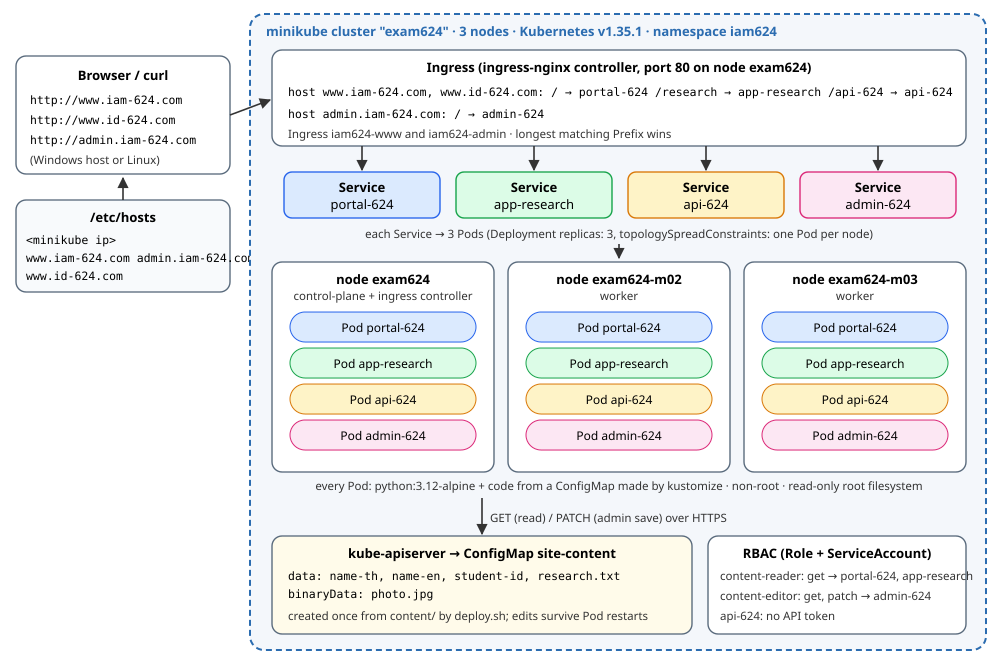

# Lab-k8s-EXAM

ระบบเว็บ `iam-624` บน Kubernetes 3 node (minikube) แยกบริการด้วย Ingress
ผู้จัดทำ: ปฐมทัศน์ ภูวนกุลชัย (Pathomtad Phoovanakulchai) รหัส 68130624

## บริการที่ให้

| URL | Deployment | ผลลัพธ์ |
|---|---|---|
| `www.iam-624.com` | `portal-624` | รูปและชื่อ ปฐมทัศน์ ภูวนกุลชัย |
| `www.iam-624.com/research` | `app-research` | สรุปงานวิจัยที่นำเสนอในวิชาสัมมนา (435 คำ นับด้วย PyThaiNLP newmm) |
| `www.iam-624.com/api-624/<ข้อความ>` | `api-624` | แสดง `<ข้อความ>` ตัวใหญ่กลางจอ |
| `admin.iam-624.com` | `admin-624` | หน้าปุ่มสองปุ่ม เลือกแก้ไขข้อมูลของ portal (ชื่อ รหัส รูป) หรือ research |
| `www.id-624.com` | เหมือน `www.iam-624.com` | ชื่อที่ใช้เข้าถึงระบบตามโจทย์ ใช้ path เดียวกันทุกตัว |

ทุก Deployment มี 3 replica และ `topologySpreadConstraints` จึงมี Pod หนึ่งตัวบนแต่ละ node (`exam624`, `exam624-m02`, `exam624-m03`). Footer ของทุกหน้าบอกชื่อ Pod และ node ที่ตอบ.

## สถาปัตยกรรม



- **CNI kindnet:** Pod บน node ต่างกันคุยกันได้ (แต่ละ node ได้ podCIDR ของตัวเอง). ต้องใช้ CNI ที่รองรับหลาย node; bridge CNI ของ minikube แบบ node เดียวใช้ไม่ได้.
- **Ingress** (`k8s/ingress.yaml`): host `www.iam-624.com` และ `www.id-624.com` ส่ง `/` ไป portal-624, `/research` ไป app-research, `/api-624` ไป api-624. host `admin.iam-624.com` ส่งทั้งหมดไป admin-624.
- **ข้อมูลที่แก้ไขได้อยู่ใน ConfigMap `site-content`** (ชื่อ, รหัส, รูป, สรุปงานวิจัย). Pod อ่านผ่าน Kubernetes API ทุกคำขอ และ admin-624 บันทึกด้วย PATCH. ทุก Pod บนทุก node เห็นข้อมูลใหม่ทันที และข้อมูลอยู่รอดเมื่อ Pod ถูกลบ. ไม่ใช้ PVC เพราะ storage ตั้งต้นของ minikube เป็น hostPath บน node เดียว ซึ่ง Pod บน node อื่นมองไม่เห็น.
- **RBAC** (`k8s/rbac.yaml`): ServiceAccount `content-reader` (portal-624, app-research) ทำได้แค่ `get`. `content-editor` (admin-624) ทำได้ `get` และ `patch`. ทั้งสองใช้ได้กับ ConfigMap `site-content` เท่านั้น. api-624 ไม่มี token.
- **ไม่ต้อง build image.** ทุก Pod ใช้ `python:3.12-alpine` และ mount โค้ดจาก ConfigMap ที่ kustomize สร้างจาก `apps/`. แก้โค้ดแล้ว `kubectl apply -k .` Pod จะถูกสร้างใหม่เอง.
- **ความปลอดภัยเบื้องต้น:** Pod ไม่รันเป็น root, root filesystem อ่านอย่างเดียว, ไม่มี capability. ข้อความจาก URL และฟอร์มถูก HTML-escape. ทุกหน้าส่ง `Content-Security-Policy`. หน้า admin รับรูป JPEG ไม่เกิน 600 KB เท่านั้น. หน้า admin ยังไม่มีการล็อกอินตามขอบเขตของโจทย์.

## โครงสร้างไฟล์

```
Lab-k8s-EXAM/
├── README.md
├── deploy.sh               สคริปต์ deploy (Linux/macOS)
├── deploy.cmd              สคริปต์ deploy (Windows)
├── hosts.txt               บรรทัดที่ต้องเพิ่มใน /etc/hosts
├── kustomization.yaml      สร้าง ConfigMap โค้ดจาก apps/ และรวม manifest ทั้งหมด
├── k8s/
│   ├── namespace.yaml      namespace iam624
│   ├── rbac.yaml           ServiceAccount, Role, RoleBinding
│   ├── portal-624.yaml     Deployment + Service
│   ├── app-research.yaml   Deployment + Service
│   ├── api-624.yaml        Deployment + Service
│   ├── admin-624.yaml      Deployment + Service
│   └── ingress.yaml        Ingress iam624-www และ iam624-admin
├── apps/                   โค้ด Python (stdlib อย่างเดียว)
│   ├── common.py           หน้าเว็บ, header ความปลอดภัย, HTTP server, อ่าน/บันทึก site-content
│   ├── portal/ research/ api/ admin/   app.py ของแต่ละบริการ
├── content/                ข้อมูลตั้งต้นของ ConfigMap site-content (ชื่อ, รหัส, photo.jpg, research.txt)
├── tools/                  สคริปต์เก็บหลักฐานและสร้าง PDF (collect.py, capture.py, build_pdf.py)
└── docs/                   รายงาน PDF, แผนภาพ, ภาพหน้าจอ, ผลตรวจ
```

## Deploy

ต้องมี minikube และ kubectl. RAM ว่างประมาณ 8-9 GB (3 node x 3 GB; VM ของ minikube ที่ได้ 2 GB บูตไม่ขึ้น).

```bash
./deploy.sh                 # Linux/macOS; ตั้ง DRIVER=docker หรือ kvm2 ได้
deploy.cmd                  # Windows; lab นี้ใช้ set DRIVER=vmware
```

สคริปต์ทำขั้นตอนเหล่านี้ตามลำดับ:

```bash
minikube start -p exam624 --nodes 3 --cni kindnet --memory 3072 --cpus 2        # cluster 3 node
kubectl get nodes -o wide
minikube addons enable ingress -p exam624
kubectl wait -n ingress-nginx --for=condition=ready pod -l app.kubernetes.io/component=controller --timeout=180s
kubectl apply -k .
kubectl create configmap site-content -n iam624 --from-file=content/   # ครั้งแรกเท่านั้น
kubectl wait -n iam624 --for=condition=available deployment --all --timeout=180s
kubectl get pods -n iam624 -o wide
```

จากนั้นเพิ่มชื่อโดเมนในไฟล์ hosts ของเครื่องที่เปิดเบราว์เซอร์:

```bash
# Linux / macOS
echo "$(minikube ip -p exam624)  www.iam-624.com  admin.iam-624.com  www.id-624.com" | sudo tee -a /etc/hosts
# Windows: เปิด PowerShell แบบ Administrator
Add-Content C:\Windows\System32\drivers\etc\hosts "$(minikube ip -p exam624)  www.iam-624.com  admin.iam-624.com  www.id-624.com"
```

ถ้า minikube ใช้ไดรเวอร์ docker บน Windows หรือ macOS ให้รัน `minikube tunnel -p exam624` ค้างไว้ และใช้ `127.0.0.1` แทน IP.

## ตรวจสอบ

```bash
kubectl get nodes -o wide
kubectl get deploy,svc,ingress,configmap -n iam624
kubectl get pods -n iam624 -o wide          # คอลัมน์ NODE: แต่ละ Deployment มี Pod บนทั้ง 3 node
kubectl describe ingress -n iam624
kubectl auth can-i patch configmap/site-content -n iam624 --as=system:serviceaccount:iam624:content-reader   # no

IP=$(minikube ip -p exam624)
curl --resolve www.iam-624.com:80:$IP http://www.iam-624.com/
curl --resolve www.iam-624.com:80:$IP "http://www.iam-624.com/api-624/สวัสดี"
curl --resolve admin.iam-624.com:80:$IP http://admin.iam-624.com/
```

`python tools/collect.py` รันชุดทดสอบ 24 ข้อ และเก็บผล `kubectl get/describe` ไว้ใน `docs/evidence/`. `python tools/capture.py` ถ่ายภาพหน้าจอ Chrome และ PowerShell ของทุกบริการ. `python tools/build_pdf.py` สร้าง PDF สองไฟล์:

- `docs/K8s-EXAM-รายงาน.pdf`: การออกแบบ, ภาพสถาปัตยกรรม, manifest, ไฟล์ hosts, ขั้นตอน kubectl และผล get/describe
- `docs/test-service-การทำงาน.pdf`: ผลทดสอบและภาพหน้าจอของทุก service

## ลบ

```bash
kubectl delete -k .          # ลบ namespace iam624 และทุก resource รวมถึง site-content
minikube delete -p exam624   # ลบ cluster
```
